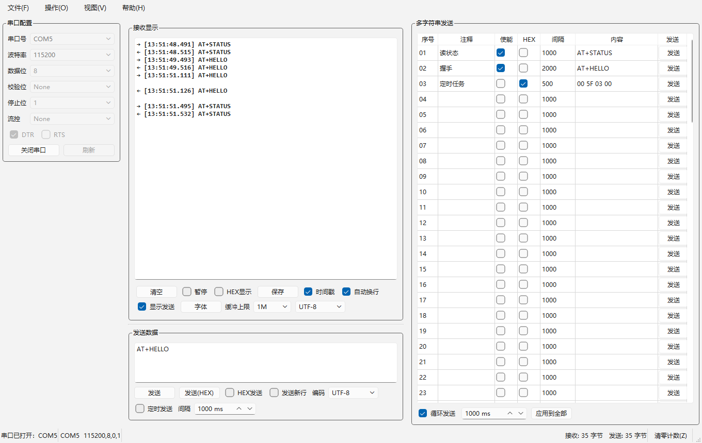

# SerialMate

[简体中文](README.md) | **English**

A serial-port debugging assistant written in Qt 6. It follows the working habits of
SSCOM 5.13.1.



**Portable**: settings live in a `SerialMate.ini` next to the exe — no registry,
no `%APPDATA%`. Copy the folder to another PC and double-click.

> Succeeds [OhMySerialHelper](https://github.com/RoninQiu/OhMySerialHelper),
> archived since 2026-09-29, last version v1.2.0.

## Features

- **Serial port** — enumerate / refresh / open / close; baud, data bits, parity,
  stop bits, flow control; DTR and RTS. The port object runs on its own thread and
  the parameter controls grey out while it is open
- **Receive area** — ASCII / HEX toggle, timestamps, word wrap, pause, buffer limit
  (200K–20M), context menu, font picker. While paused, data keeps arriving and only
  the rendering stops
- **Send area** — text / HEX / append CRLF / timed send, with three encodings
  (UTF-8 / System ANSI / Latin-1)
- **Multi-string sending** — 99 rows, each with its own interval, HEX or text,
  send-one-row, loop send. Optional SSCOM config import migrates an existing
  `sscom51.ini` in one click
- **Send/receive colouring** — received lines in **blue**, sent lines in **orange**,
  with a separate palette for light and dark system themes; the marker sits ahead of
  the timestamp when timestamps are on. SSCOM has no such feature: with echo on, sent
  and received lines are literally indistinguishable. Red/green is deliberately avoided
  — around 8% of men cannot tell that pair apart, and it falsely implies "failed/OK".
- **Portable delivery** — `package.bat` produces a runnable folder and a zip archive

## Requirements

| Component | Version                        | Notes                                                 |
| --------- | ------------------------------ | ----------------------------------------------------- |
| Qt        | ≥ 6.5                          | Must include **Widgets**, **SerialPort** and **Test** |
| CMake     | ≥ 3.21                         | Available from the Qt online installer                |
| Compiler  | GCC 9+ / Clang 9+ / MSVC 2019+ | Must match the Qt kit                                 |

Verified: **Qt 6.12.0 mingw_64 + MinGW 13.1.0 + CMake 3.30.5 + Ninja**.
MSVC users need no extra setup — `CMakeLists.txt` already passes `/utf-8`.

## Building

No path is hard-coded. `qt-env.bat` tries, in order: the `QTDIR` environment
variable → derived from `windeployqt` / `qmake` already on `PATH` → if `QTDIR` is
an installer root, its first `<version>\mingw_64` kit → the installer default
`C:\Qt`. If `cmake` / `ninja` / `gcc` are already on `PATH` they are left alone.

```bat
setx QTDIR "C:\Qt\6.12.0\mingw_64"   REM set it once

build.bat          :: configure + build + launch
build.bat test     :: configure + build + run unit tests (no GUI)
```

One-shot also works: `set QTDIR=C:\Qt\6.12.0\mingw_64 && build.bat test`.

## Packaging

```bat
package.bat
```

The output is the `dist\SerialMate\` folder (**11 files / 34.9 MB**) plus
`dist\SerialMate-<version>.zip`. The version is read from `project(VERSION)` in
`CMakeLists.txt`, never hand-copied. The zip is produced with Windows' own
`tar.exe` — **no 7-Zip required** — and its top level is a folder named
`SerialMate`, so unpacking does not scatter files into your downloads directory.

`windeployqt` ships roughly 3.6 MB of things this program never uses
(`Qt6Network`, `Qt6Svg` and four plugin directories). The script excludes them
_at deploy time_ with `--no-network --no-svg --skip-plugin-types` rather than
deleting them afterwards — **the script never removes a single file**. The
trade-off is that it will not empty `dist\SerialMate\`; delete that folder by hand
before switching Qt versions. The script prints a **recursive file count** at the
end — if two runs disagree, there are stale DLLs.

The shipped ini has `state`, `geometry` and `layoutVersion` stripped from its
`[window]` section. Those are session furniture (window size, whether the panel was
showing); shipping them produced a package whose multi-string panel was invisible,
which defeats the point of shipping the ini at all.

## Migrating from SSCOM

Pick an `sscom51.ini` via _File → Import SSCOM config_. Serial parameters, receive
options, the send-box draft, all 99 multi-string rows and **each row's individual
interval** are carried over.

Encoding switches to System ANSI after import: the Chinese in SSCOM's ini was
already GBK bytes, and keeping this program's UTF-8 default would turn it all into
mojibake.

Items that cannot be migrated verbatim are listed after the import (click
"Show Details"). The important ones:

- **Data bits / parity / stop bits / flow control** — SSCOM does not persist these
  at all (hard-coded 8N1, no flow control), and this program's defaults match
- **Receive timestamp** — SSCOM's "add timestamp" and "split packet display" share
  one checkbox, so only the latter exists in the config
- **Multi-string "enabled" column** — the first field's meaning cannot be
  determined, so every row imports unchecked; tick the ones you want

## Where settings live

**`SerialMate.ini` next to the exe**:

```ini
[serial]     port=COM1  baud=115200  dataBits=8  parity=0
             stopBits=1  flow=0  dtr=true  rts=false
[recv]       hex=false  timestamp=false  wrap=true  showSent=false
             bufferLimit=1000000  encoding=0  font="Consolas,10,-1,5,400,..."
[send]       text=  appendCrlf=false  hexMode=false  intervalMs=1000  encoding=0
[loop]       enabled=false  intervalMs=100
[sendItems]  size=99
1\name=  1\enabled=false  1\hexMode=false  1\intervalMs=1000  1\content=
```

Delete the file to reset to defaults.

> `QSettings(org, app)` is deliberately not used: on Windows that form goes to the
> registry, which is the shape of "software that was installed" — invisible to the
> user, undeletable, unportable, and leaving residue behind on uninstall.

## Known limitations

- **Not implemented**: auxiliary tools such as checksums (FR-09).
  "Send file" (FR-03-6) has been removed
- **Packaging stops at "runnable folder + zip"**: no installer, no code signing.
  No single-file exe either — statically linking Qt was evaluated and abandoned
- **Saving received data uses two dialogs** (file chooser, then a question about
  stripping markers). `QFileDialog` in Qt 6 has no interface for attaching extra
  widgets, and a confirm button that never returns would mean "Save hangs" —
  considerably worse than one extra question
- **Each multi-string row has its own interval**, meaning "how long to wait after
  _this_ row before sending the next", range 1..600000 ms. The bottom box became
  "Apply to all"
- **The buffer limit counts UTF-16 code units** — roughly a byte count for the
  ASCII/binary data that dominates here, but high for CJK text
- **Switching HEX / timestamp does not re-render already displayed text**; it only
  affects newly arriving data
- **Multi-line input in the send area is transmitted as LF, not CRLF**
- **An invalid baud rate silently falls back to 9600** with no warning
- **RTS is auto-disabled under hardware flow control** (the line is occupied by the
  flow-control logic, so setting it would fail silently)
- **The cross-thread send/receive path is verified on real hardware** (COM5 with TX-RX
  shorted, 27 assertions × 4 runs, all green). **Full-duplex concurrency and hardware
  flow control are not verified** — with two wires shorted there is no peer

## Layering constraints

```
ui/  →  core/  →  models.h
```

`core/` must **never** depend back on `ui/`. Check yourself when adding code:

```bash
grep -rn '#include "ui/' src/core/     # must produce no output
```

## License

MIT — see [LICENSE](LICENSE).

This is an **independent implementation**. No source code, decompiled output, icons
or other assets from SSCOM or its authors were used. SSCOM is mentioned for two
reasons only: to describe the use case this tool targets, and to provide an
**optional** config import that parses the INI text on the user's own machine and
contains nothing from the original, so nobody has to retype 99 rows.
